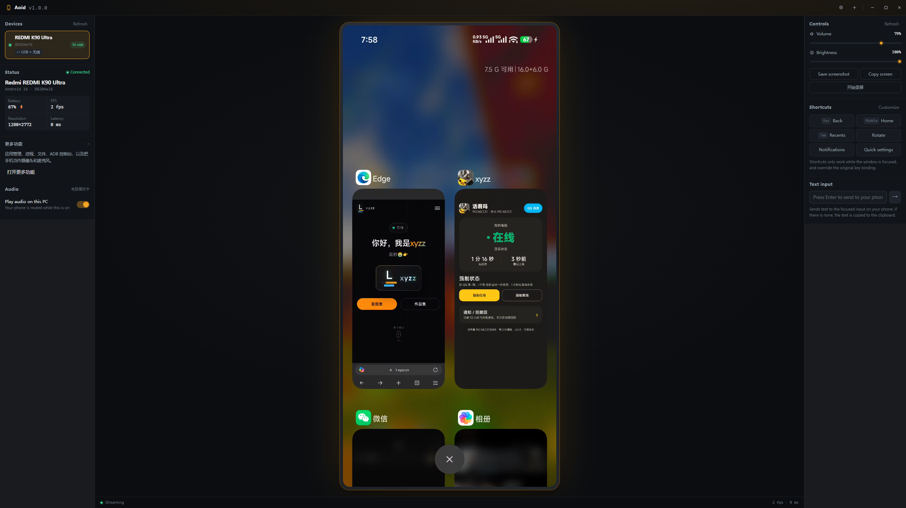

# Aoid

**Control your Android phone from your Windows PC over USB.**

Aoid is a lightweight desktop app that mirrors your phone's screen and lets you interact with it using your mouse and keyboard. No app installation on the phone. No root required.

[](LICENSE)
[](https://github.com/l-xyzz/Aoid/releases)
[](https://github.com/l-xyzz/Aoid/releases)

> ⚠️ **Early development.** Aoid is a beta with known rough edges. Not recommended for production use yet — but feedback is very welcome.



---

## Features

- **Live screen mirroring** — H.264 over USB, hardware-decoded via WebCodecs, 30–60 fps
- **Responsive input** — clicks, drags, long-presses and scroll wheel forwarded instantly
- **Text input** — including CJK and emoji, via clipboard-assisted typing
- **Wireless debugging** — pair with a code or connect by IP, then drop the cable
- **Volume & brightness** — two-way sync with instant feedback
- **Screenshots & recording** — lossless PNG screenshots, MP4 screen recording
- **Peripherals** — use the phone as a webcam or microphone
- **Clipboard sync** — optional, bidirectional
- **Toolbox** — app manager, process manager, two-pane file manager, and a built-in ADB console with autocomplete
- **Multi-language** — English and Simplified Chinese built in; load your own language pack

## Why another scrcpy GUI?

Aoid focuses on three things:

1. **Small and dependency-free.** Zero runtime npm dependencies. Everything is plain JSON and vanilla JavaScript on top of Electron.
2. **Honest engineering.** When a shortcut doesn't work, the fix goes in the code with a comment explaining why — not a workaround that hides the symptom.
3. **Hackable.** Language packs are plain JSON you can generate with any LLM. The update checker speaks the public GitHub API.

## Install

Download from [Releases](https://github.com/l-xyzz/Aoid/releases):

| File | What it is |
| --- | --- |
| `Aoid-<version>-Setup.exe` | Installer (recommended) — creates shortcuts, includes an uninstaller |
| `Aoid-<version>-Portable.exe` | Portable single file — no registry writes |
| `Aoid-<version>-win-x64.zip` | Unpacked folder — extract and run |

**Requirements**: Windows 10/11 (64-bit), Android 5.0+

On first launch Windows SmartScreen will warn you — there is no code-signing certificate. Click **More info** → **Run anyway**.

## Quick start

1. **Enable USB debugging** — Settings → About phone → tap *Build number* 7 times, then Developer options → USB debugging
2. **Connect** — plug in the cable, tap *Allow* on the phone
3. **Launch Aoid** — your device appears on the left, click it

Full instructions are in the app under **Settings → About → User guide**.

## Build from source

```bash
git clone https://github.com/l-xyzz/Aoid.git
cd Aoid
npm install
npm run fetch:runtime   # scrcpy runtime (~18 MB)
npm run bundle:tools    # adb (~8 MB)
npm start
```

Requires Node.js 20+. Packaging: `npm run dist:safe` produces the installer, portable build, and zip.

## Known issues

| Issue | Status |
| --- | --- |
| Occasional stutter or tearing | Being optimized; worst on resolution changes |
| Rotation takes a second or two | Frame is frozen and the channel reconnects |
| Wireless drops on weak networks | Auto-retries 3 times |
| Camera / microphone | Works, not fully tested |
| No code signing | SmartScreen warning on first run |
| Windows x64 only | macOS / Linux not planned yet |

## How it works

Under the hood Aoid runs the official [scrcpy](https://github.com/Genymobile/scrcpy) server on the phone and speaks its protocol directly:

- Video arrives as Annex-B H.264 over an `adb reverse` abstract socket
- Frames go straight into a WebCodecs `VideoDecoder` and are drawn to a canvas
- Touch and key events are injected using scrcpy's control protocol, which is faster than `adb shell input`

**One rule drives the whole design**: never drop a video frame. H.264 P-frames reference earlier frames, so dropping one corrupts everything after it. Smoothness is handled at the display layer instead.

## Contributing

Issues and pull requests are welcome. Please read [CONTRIBUTING.md](CONTRIBUTING.md) first — it documents the non-obvious pitfalls (Android 16 socket restrictions, decoder recovery, IPC channel naming).

- 🐛 [Report a bug](https://github.com/l-xyzz/Aoid/issues/new/choose)
- 💡 [Request a feature](https://github.com/l-xyzz/Aoid/issues/new/choose)
- 🔒 [Security policy](SECURITY.md)

## Privacy

Aoid runs entirely on your machine. No telemetry, no analytics, no accounts. See [PRIVACY.md](PRIVACY.md).

## License

[MIT](LICENSE) for the source code. Bundled third-party binaries keep their own licenses — see [THIRD-PARTY-NOTICES.md](THIRD-PARTY-NOTICES.md).

---

*Not affiliated with Google, Genymobile, or the scrcpy project.*
