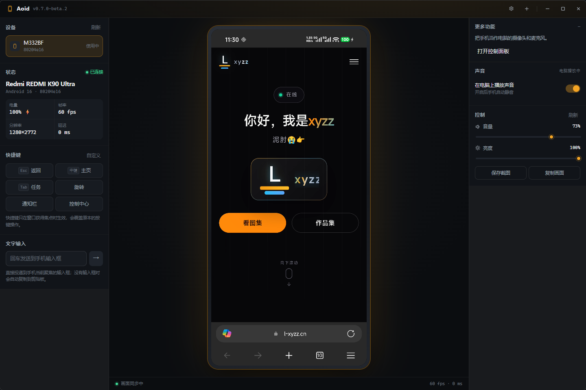

# Aoid

**Lightweight Android screen mirroring & remote control for Windows.**
**Windows 安卓投屏控制工具 —— 有线/无线直连，手机端无需装 App，不需要 root。**

[](https://github.com/l-xyzz/Aoid/releases)
[](LICENSE)
[](https://github.com/l-xyzz/Aoid/releases)
[](https://github.com/l-xyzz/Aoid/releases)



---

## 为什么是 Aoid，而不是直接用 scrcpy

scrcpy 是极优秀的工具，但它只有命令行。Aoid 在它的服务端之上做了一层**完整的桌面应用**：

| | scrcpy | **Aoid** |
| --- | --- | --- |
| 交互方式 | 命令行参数 | **图形界面，点开就能用** |
| 无线连接 | 手动敲 `adb pair` / `adb connect` | **内置配对向导，按提示填 IP 和配对码** |
| 中文输入 | 需自行配置输入法 | **输入框直接打字，中文/emoji 都能进手机** |
| 文件传输 | 命令行 `adb push/pull` | **双栏文件管理器，点一下就过去** |
| 调试 | 另开终端 | **内置 ADB 控制台，带命令补全与语法高亮** |
| 语言 | 英文 | **中英双语，可加载任意语言包** |
| 快捷键 | 固定 | **可自定义，鼠标键也能绑** |

一句话：**Aoid 把 scrcpy 的能力，装进了一个不用查文档就能用的界面里。**

---

## 核心亮点

- **实时画面** —— USB 传输 H.264，硬件解码，实测 30~60 fps
- **跟手触控** —— 点击、拖动、长按、滚轮即时转发，鼠标拖出画面也不中断
- **中文输入** —— 支持中文、emoji，走剪贴板粘贴，兼容性最好
- **无线调试** —— 配对码或 IP 直连，配对后可以拔掉数据线
- **录屏与截图** —— 一键录 MP4，或保存手机原始分辨率无损 PNG
- **文件管理** —— 左手机右电脑双栏，记住上次位置，可切换任意磁盘
- **ADB 控制台** —— 命令历史、Tab 补全、语法高亮、输出可选中复制
- **手机当摄像头/麦克风** —— 开会、直播都能用
- **自动更新** —— 检查新版本，显示更新说明，确认后自动升级

---

## 下载

到 [Releases](https://github.com/l-xyzz/Aoid/releases) 下载，三种形式按需选择：

| 文件 | 用途 | 说明 |
| --- | --- | --- |
| `Aoid-<版本>-Setup.exe` | **安装包**（推荐） | 向导式安装，自动创建快捷方式，自带卸载程序 |
| `Aoid-<版本>-Portable.exe` | 便携版 | 单文件，双击即用，不写注册表，可放 U 盘 |
| `Aoid-<版本>-win-x64.zip` | 免安装目录 | 解压即用，适合内网分发 |

> **第一次运行会被 Windows 拦截**，提示「Windows 已保护你的电脑」。
> 这是因为没有购买代码签名证书，点「**更多信息**」→「**仍要运行**」即可。

**系统要求**：Windows 10 / 11（64 位）。手机需 Android 5.0 以上。

---

## 快速开始

三步就能用上：

1. **手机开启 USB 调试** —— 设置 → 关于手机 → 连点「版本号」7 次 → 开发者选项 → 打开「USB 调试」
2. **插上数据线** —— 手机上弹出授权窗口时点「允许」
3. **打开 Aoid** —— 左侧会出现这台设备，点它就能看到画面

<details>
<summary><b>无线调试（Android 11 以上，免数据线）</b></summary>

1. 手机与电脑连同一个 Wi-Fi
2. 手机「开发者选项 → 无线调试」→ 开启
3. 点「使用配对码配对设备」，记下 **IP:端口** 和 **6 位配对码**
4. Aoid 里「添加设备 → 无线连接」，填入配对信息，点「配对」
5. 配对成功后，用不带配对码的 IP:端口 连接

</details>

---

## 已知限制

Aoid 已经发布 1.0.0，核心功能可用，但仍在快速迭代，部分设备上的兼容性还在完善。

<details>
<summary><b>已知问题（点击展开）</b></summary>

| 问题 | 现状 |
| --- | --- |
| 画面偶发卡顿 / 撕裂 | 已在持续优化，切换分辨率时最明显 |
| 横竖屏热切换需要几秒恢复 | 通过锁帧 + 后台重连处理，期间画面短暂静止 |
| 无线连接稳定性 | 弱网下容易断，断线会自动重连 3 次 |
| 麦克风 / 虚拟摄像头 | 功能可用但未充分测试，需要 VB-Cable / OBS 支持 |
| 代码签名 | 无，首次运行有 SmartScreen 提示 |
| 平台 | 目前只支持 Windows x64 |

</details>

遇到问题请按 [Issue 模板](https://github.com/l-xyzz/Aoid/issues/new/choose) 反馈，
**请务必写明手机型号、Android 版本与复现步骤**，这对定位非常关键。

---

## 多语言

内置**简体中文**与**English**。其他语言可以自己加：

设置 → 通用 → 自定义语言 → 「打开语言文件夹」，会生成一份 `_模板.json`。
把它交给 AI 翻译成任意语言，存成 `<语言代码>.json` 放回该文件夹，
点「重新扫描语言」就能在下拉框里选到。

语言包格式是「中文原文 → 译文」的纯文本对照表，不需要改任何代码。

---

## 从源码构建

```bash
git clone https://github.com/l-xyzz/Aoid.git
cd Aoid
npm install
npm run fetch:runtime   # 下载 scrcpy 运行组件（scrcpy.exe / SDL2 / ffmpeg，约 18MB）
npm run bundle:tools    # 下载 adb（约 8MB）
npm start               # 启动应用
```

需要 Node.js 20 以上。

> `scrcpy-runtime/` 和 `platform-tools/` 不进仓库（体积大且可重新下载），
> 所以 clone 之后**必须先跑上面两条下载命令**，否则画面和触控都无法工作。

<details>
<summary><b>国内网络下载慢</b></summary>

仓库里的 `.npmrc` 刻意没有写死镜像源，以保证国内外都能正常安装。
如果你在国内，可以临时设置环境变量（不要改 `.npmrc`）：

```bash
npm config set registry https://registry.npmmirror.com
set ELECTRON_MIRROR=https://npmmirror.com/mirrors/electron/
set ELECTRON_BUILDER_BINARIES_MIRROR=https://npmmirror.com/mirrors/electron-builder-binaries/
```

</details>

### 打包

```bash
npm run dist:safe   # 推荐：在本地磁盘构建，产出安装包 + 便携版 + zip
npm run dist        # 直接调用 electron-builder
```

`dist:safe` 会先把项目复制到本地磁盘再打包 —— 因为 **Electron 无法从网络驱动器（如 Z:）启动**，
产物落在网络盘上会导致双击毫无反应。

详细的打包选项、产物说明、发布流程见 [贡献指南的「打包」一节](CONTRIBUTING.md#打包)。

---

## 技术路线

| 环节 | 做法 | 为什么 |
| --- | --- | --- |
| 画面采集 | scrcpy-server v5.0.1 | 设备端直接抓 Surface，硬件编码持续输出 H.264，最轻最稳 |
| 传输 | `adb reverse` 抽象 socket | Android 16 禁止 shell 设置 `ANDROID_SOCKET_*`，只能走反向转发 |
| 解码 | WebCodecs `VideoDecoder` | 浏览器原生接口，直接走硬件解码，无需封装容器 |
| 渲染 | Canvas 2D `drawImage` | 每帧一次 GPU 拷贝，不产生 DOM 对象 |
| 触控 | scrcpy 控制协议 | 直接注入，延迟低于 `adb shell input` |
| 中文输入 | 剪贴板 + 粘贴键 | `adb input text` 不支持非 ASCII，输入法注入在国产 ROM 上常失效 |

**一条铁律**：视频码流必须完整连续，一帧都不能丢。
H.264 的 P/B 帧依赖前面已解码的帧作参考，丢任意一帧都会让后续全部参考错乱、画面崩坏。
流畅度只能在显示层解决（只画最新帧），不能在输入层丢帧。

## 目录结构

```
src/
  main/           主进程
    core/         共享状态、IPC 注册封装、路径解析
    session/      连接与画面通道生命周期
    ipc/          按域拆分的 IPC：device / settings / screen / features / wireless / tools
    scrcpy.js     scrcpy 服务端通道（视频流解析、控制协议）
    adb.js        adb 封装
    updater.js    自动更新
  renderer/       渲染进程
    js/app.js     界面主逻辑
    js/player.js  WebCodecs 解码 + 画布渲染
    js/tools.js   更多功能窗口（应用 / 进程 / 文件 / ADB 控制台）
    styles/       样式
scripts/          构建与自检脚本
resources/        图标等
vendor/           scrcpy 服务端 jar
```

---

## 参与

- 有 bug 或建议 → [提 Issue](https://github.com/l-xyzz/Aoid/issues/new/choose)
- 想贡献代码 → 见 [CONTRIBUTING.md](CONTRIBUTING.md)
- 安全问题 → 见 [SECURITY.md](SECURITY.md)

如果 Aoid 对你有帮助，点个 Star 是对这个项目最实在的支持。

## 关于第三方组件

| 组件 | 用途 | 许可 |
| --- | --- | --- |
| [scrcpy](https://github.com/Genymobile/scrcpy) 服务端 | 手机端画面采集与输入注入 | Apache-2.0 |
| [platform-tools](https://developer.android.com/tools/releases/platform-tools) 中的 adb | 与手机通信 | Apache-2.0 |
| [SDL2](https://github.com/libsdl-org/SDL) | scrcpy 的窗口与音频输出 | zlib |
| [FFmpeg](https://ffmpeg.org/) | scrcpy 的音视频编解码 | LGPL / GPL（依构建配置） |
| [Electron](https://www.electronjs.org/) | 桌面运行时 | MIT |

完整清单与许可证全文见 [THIRD-PARTY-NOTICES.md](THIRD-PARTY-NOTICES.md)。

**本项目仅参考了 [QtScrcpy](https://github.com/barry-ran/QtScrcpy) 的架构思路（GPL-3.0），未使用其任何代码。**

## 隐私

完全在本机运行，不连任何服务器，不收集任何数据。详见 [PRIVACY.md](PRIVACY.md)。

## 许可

本项目代码以 [MIT](LICENSE) 许可发布。随附的第三方二进制遵循各自许可。
